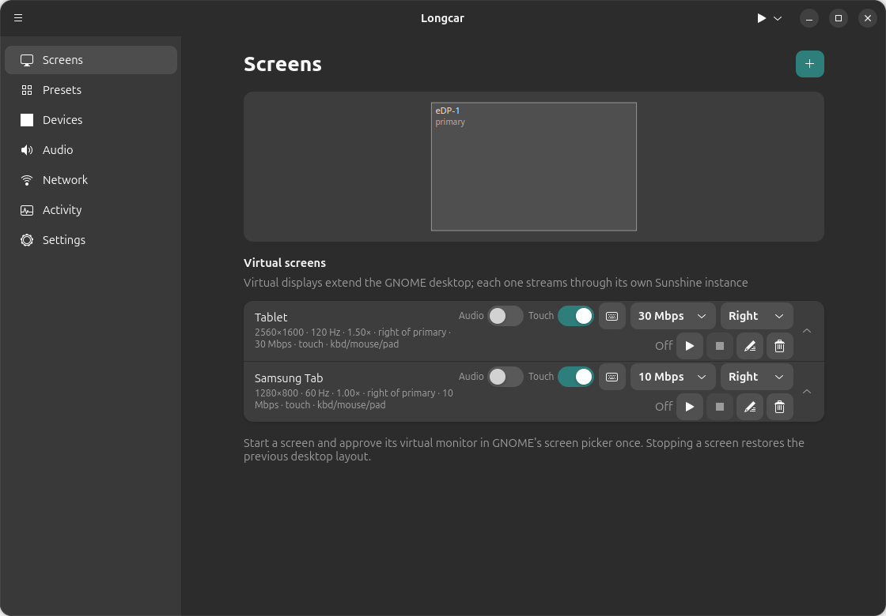
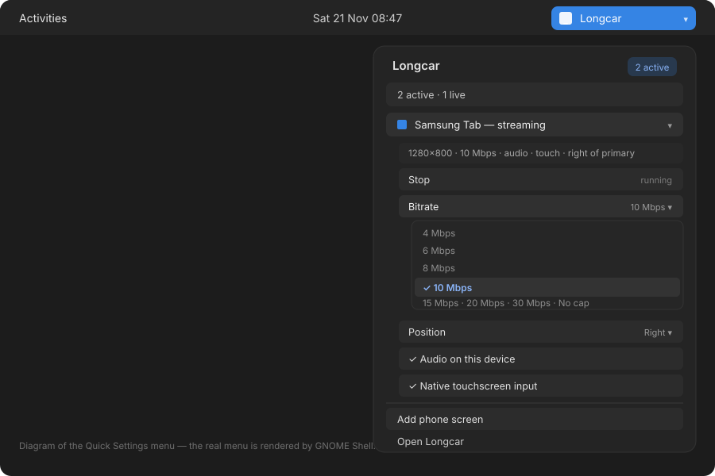
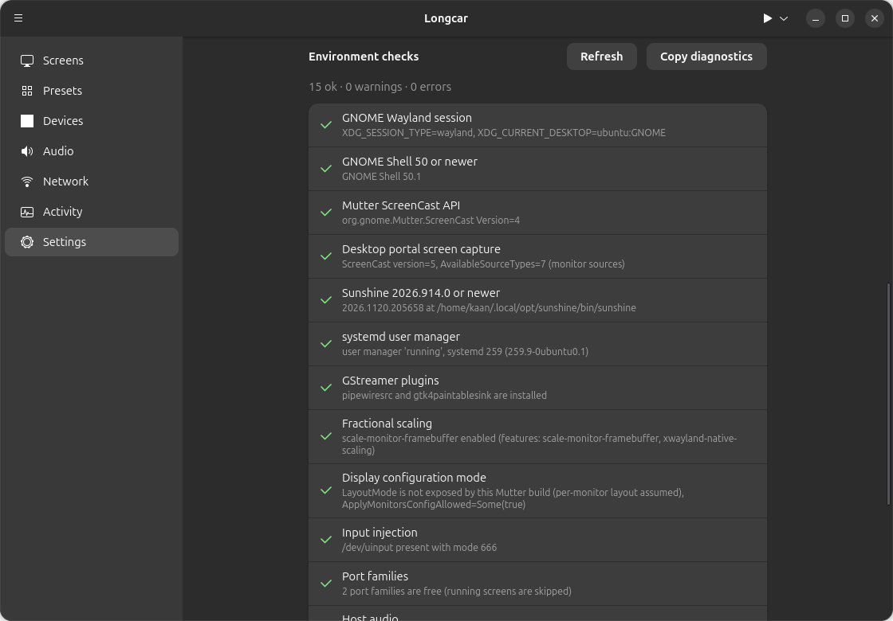
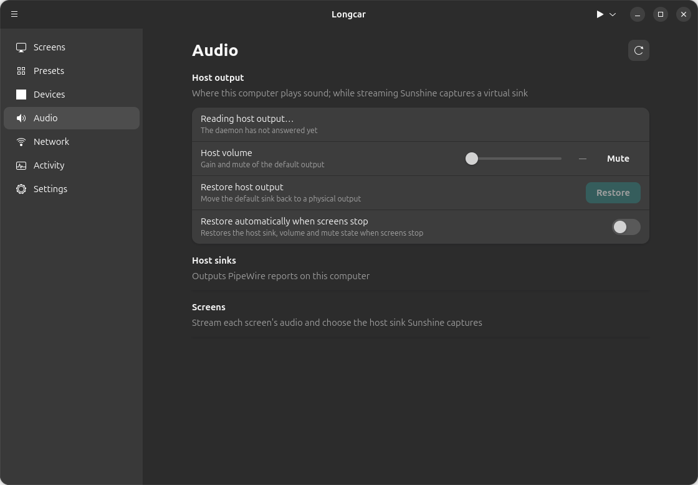

<div align="center">


# Longcar

**Virtual displays for Sunshine and Moonlight — turn a tablet or phone into an extra GNOME screen.**

[](LICENSE)
[](https://www.gnome.org/)
[](https://www.rust-lang.org/)
[](https://github.com/ta4anx/longcar/releases)
[](https://github.com/ta4anx/longcar/wiki)

[Install](#install) · [First run](#first-run) · [Quick Settings](#quick-settings) · [Settings](#settings) · [CLI](#cli) · [Wiki](https://github.com/ta4anx/longcar/wiki) · [Troubleshooting](https://github.com/ta4anx/longcar/wiki/Troubleshooting)

</div>

---

Longcar creates a **real virtual monitor** on GNOME Wayland through Mutter's ScreenCast
API, places it next to your physical monitors, and streams it to a **Moonlight** (tablet)
or **Artemis** (phone, portrait) client — with one isolated stock **Sunshine** instance
per screen, so each device is its own pair-able host.

It extends the **GNOME desktop**, not Android's display topology: the tablet shows a
fullscreen stream of a GNOME monitor, and windows you drag onto it behave like any other
display.



## Why it is built this way

- **Mutter, not vkms** — virtual outputs come from `org.gnome.Mutter.ScreenCast`, so they
  are real displays with real modes, fractional scaling and input.
- **One Sunshine process per screen** — Sunshine's portal identity and capture target are
  process-global, so each screen gets its own transient systemd unit, private config
  directory, port family and pairing database.
- **Temporary layouts only** — `ApplyMonitorsConfig` is used with the verify + temporary
  methods, so a crash can never rewrite your saved display configuration. The previous
  layout is snapshotted and restored on stop.

## Features

| | |
| --- | --- |
| 🖥️ **Virtual outputs** | Any resolution/refresh the GPU supports, scale clamped to Mutter's list, placed left/right/above/below with start/center/end alignment |
| 🎛️ **Presets** | Start a set of screens with one click; preset editing in the app |
| 📱 **Audio page** | Per-device routing, host sink choice, volume/mute per sink, and a guard that restores your speakers after a killed stream |
| 👆 **Input per device** | Touchscreen vs pointer, and keyboard / mouse / controller switches per screen |
| ⚡ **Quick bitrate/layout** | 4–30 Mbps presets and position changes from the app rows *and* the Quick Settings menu |
| 📶 **Network page** | Host Wi-Fi link (SSID, signal, negotiated rates, channel) and a real end-to-end throughput test you open on the tablet — no app install needed |
| 🔌 **Pairing** | PIN approval and client management (enable/disable/unpair) from the app or `longcarctl` |
| 🩺 **Doctor** | 14 checks (session, Mutter, portal, Sunshine, GStreamer, ports, uinput, extension…) with one-click fixes, now inside Settings |
| 📈 **Activity** | Bitrate sparkline, fps, codec, duration and session history |
| 🧩 **GNOME 50 extension** | Toggle, per-screen submenus, presets, bitrate, layout, audio and touch |

## Requirements

- **GNOME 50 on Wayland** (Mutter ScreenCast ≥ 4, `layout-mode == 1`).
- **Fractional scaling enabled** (`scale-monitor-framebuffer` in Mutter's experimental
  features) — virtual outputs are usually scaled.
- **Native Sunshine 2026.914.0 or newer.** The Flatpak build is detected and refused:
  Longcar needs per-screen process isolation.
- `systemd --user` with `systemd-run` (one transient unit per screen).
- Stock **Moonlight** for tablets, **Artemis** for phones in portrait.

## Install

### Debian package

```bash
sudo apt install ./longcar_0.2.0_amd64.deb
longcarctl setup            # Shell extension + user service
```

Then **log out and back in once on Wayland** — the Quick Settings indicator is created at
Shell startup.

### From source

```bash
cargo build --release --workspace
./scripts/install-dev.sh    # ~/.local + the Shell extension
./scripts/run-dev.sh        # daemon + GUI from the tree
```

### Sunshine

```bash
sudo apt install ./sunshine_*.deb        # native package, not Flatpak
longcarctl doctor                        # must show "sunshine ok"
```

If you keep Sunshine outside `PATH`, export `SUNSHINE_BIN=/abs/path/to/sunshine` for the
daemon (`systemctl --user edit longcar-daemon` → `Environment=`).

## First run

1. `longcarctl doctor` — fix anything reported (`longcarctl fix <id>`).
2. Start a screen: the header ▶ button, `longcarctl start`, or the Quick Settings toggle.
3. GNOME asks you to **pick the monitor** — choose the one whose resolution matches the
   screen (e.g. `1280×800`). One approval per screen; the token is reused afterwards.
4. `longcarctl status` reaches `ready` and the virtual connector shows up in Settings →
   Displays.
5. On the tablet add a host — **the address and port from Devices → Connection info**
   (each screen has its own port: slot 0 → `48049`, slot 1 → `48109`, …).
6. Request a PIN in Moonlight, then approve it in **Devices** (or
   `longcarctl devices pending <screen>` + `longcarctl devices pair <screen> <id> <pin>`).
7. Connect. The screen becomes `streaming`; **Activity** shows bitrate and fps.

## Quick Settings



Toggle **Longcar** to start the default preset (off stops every screen). Open the menu for:

- one **submenu per screen**: state, Start/Stop, **Bitrate** presets (4/6/8/10/15/20/30
  Mbps or no cap), **Position** (left/right/above/below), **Audio** and **Touch** toggles,
- one item per preset, **Add phone screen**, **Restore layout** when one is pending, and
  **Open Longcar**.

Everything the menu does is also a D-Bus method the app uses — nothing is emulated in the
Shell, so the tile shows exactly the daemon's state.

## Settings

- **Behavior** — start screens at login, notifications, stop when idle, restore the
  desktop layout on stop.
- **Audio** — host output (default sink, volume, mute, *Restore host output*), the host
  sink list, and per-screen routing with an optional capture sink.
- **Diagnostics** (formerly the Doctor page) — the 14 checks, fixes, the display
  self-test, and copyable diagnostics.



The Screens page carries the fast controls: audio, native touch, an **Input** menu
(keyboard/mouse/controller), a bitrate preset and a position picker for each screen. Audio,
input and bitrate changes restart that screen's unit, so a live stream has to be stopped
first; position changes apply live.



The Audio page is the detailed mixer: it lists every host sink with volume and mute state,
lets you pin a screen's capture to a specific sink, warns when Sunshine's virtual sink is
still the host default, and restores the host sink, volume and mute state when screens stop
(see `longcarctl audio --restore-host` for the manual escape hatch).

## CLI

```bash
longcarctl status [--json]          longcarctl start [--preset ID] [--screen ID]
longcarctl stop [--screen ID]       longcarctl screens list|add|update|remove
longcarctl presets list|start ID    longcarctl devices pending|list|pair|unpair|enable|disable
longcarctl doctor [--json] [--self-test]   longcarctl fix FIX_ID
longcarctl network hosts|ports|link   longcarctl network speedtest [--stop|--status]
longcarctl logs -n 200
longcarctl audio [off|SCREEN] [--restore-host]   longcarctl audio   # sink overview
longcarctl screens bitrate ID KBPS | position ID left|right|above|below
longcarctl screens audio|touch ID on|off | input ID keyboard|mouse|controller on|off
longcarctl screens sink ID NAME|auto
longcarctl export [-o FILE] | import FILE --yes
longcarctl restore-layout | discard-layout
longcarctl setup [--extension-only|--service-only]
```

## Contributing

Bug reports with `longcarctl doctor --json` go a long way. See
[`CONTRIBUTING.md`](CONTRIBUTING.md) for the crate layout, the check commands and the
"stock GNOME, stock Sunshine" ground rules.

## Documentation

- **Wiki** — [Home](https://github.com/ta4anx/longcar/wiki) ·
  [Quick Settings](https://github.com/ta4anx/longcar/wiki/Quick-Settings) ·
  [Configuration](https://github.com/ta4anx/longcar/wiki/Configuration) ·
  [Troubleshooting](https://github.com/ta4anx/longcar/wiki/Troubleshooting)
- [`docs/ARCHITECTURE.md`](docs/ARCHITECTURE.md) — lifecycle, state machine, port table,
  file layout.
- [`docs/TROUBLESHOOTING.md`](docs/TROUBLESHOOTING.md) — the same fixes as the wiki page,
  offline.

## Limitations

- One Sunshine process per screen: one portal approval per screen, and some memory per
  screen.
- Screens need **unique resolutions**; GNOME's picker identifies monitors by resolution.
- Changing resolution, refresh rate, scale or cursor mode needs a new portal approval.
- GNOME shares one input seat: every stream controls the same pointer/keyboard.
- No HDR. HEVC/AV1 Main10 is a codec advertisement, not an HDR guarantee.
- Idle Moonlight clients do not advertise over mDNS.
- The throughput test is TCP and lives for 120 s; with `ufw` enabled, allow the printed port
  for that minute. It measures the link, not the stream — a good number with stutter points
  at airtime or UDP loss.
- Validated on AMD (renoir) with the software encoder; NVIDIA/Intel are untested, and
  VAAPI needs a DRM render node (`/dev/dri/renderD*`).
- The requested scale is clamped to the closest scale Mutter offers.

## Security

Longcar listens on your LAN only. The daemon has no persistent network listener: the only
socket is the on-demand speed test (random token URL, three fixed routes, fixed payload, no
filesystem access, closes after the report or 120 s).

- Do not forward Sunshine ports from the internet. Paired clients get keyboard and mouse
  control of your desktop.
- Sunshine API credentials are generated per screen, stored `0600`, and never logged.
- Portal restore tokens are per instance and `0600`.
- Pair only devices you trust; unpair from Devices when you stop using one.

## Credits

- [lirenzzzin/gnome-wayland-virtual-monitors-sunshine](https://github.com/lirenzzzin/gnome-wayland-virtual-monitors-sunshine)
  (Unlicense) — the Mutter `RecordVirtual` + portal capture approach.
- [Sunshine](https://github.com/LizardByte/Sunshine), [Moonlight](https://github.com/moonlight-stream/moonlight-qt),
  [Artemis](https://github.com/ClassicOldSong/moonlight-android).
- GNOME Shell, Mutter, GTK and libadwaita.

Longcar is licensed **GPL-3.0-or-later**.
