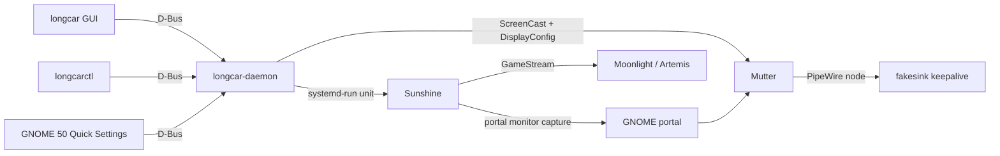
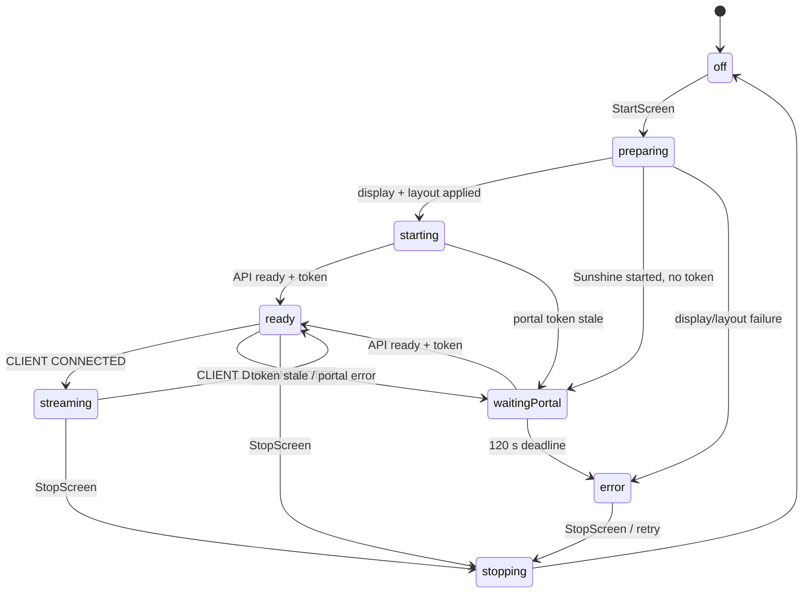

# Longcar architecture

Longcar turns a tablet or phone into an extended GNOME desktop screen. It creates a
virtual monitor with Mutter's private ScreenCast API, places it next to the physical
monitors with `ApplyMonitorsConfig`, and runs one isolated stock Sunshine instance per
screen so a Moonlight (tablet) or Artemis (phone, portrait) client can connect to it.

The tablet does **not** get a second Android display; it sees a fullscreen stream of a
GNOME virtual monitor.

## Components

| Component | Binary / artifact | Responsibility |
| --- | --- | --- |
| `longcar-core` | library | config, model, layout planner, ports, Sunshine config/API/log parsing, state JSON, network helpers |
| `longcar-display` | library | Mutter `ScreenCast` + `DisplayConfig` clients, GStreamer keepalive pipeline |
| `longcar-daemon` | `longcar-daemon` | orchestration, Sunshine instances, layout lifecycle, D-Bus service, doctor |
| `longcar-gui` | `longcar` | GTK4/libadwaita app |
| `longcar-cli` | `longcarctl` | command line client |
| Shell extension | `longcar@ta4anx.github.io` | Quick Settings toggle and menu |

D-Bus control plane: bus name `io.github.ta4anx.Longcar.Daemon`, object path
`/io/github/ta4anx/Longcar/Daemon`, interface
`io.github.ta4anx.Longcar.Daemon.Control`, signal `StateChanged(s json)`.

There is no persistent network listener. The one socket the daemon ever opens is the
on-demand throughput test: it binds an ephemeral TCP port on the LAN when the user asks for
it, serves exactly three routes behind a 32-hex token (`/`, `/payload`, `/upload`,
`/report`), never touches the filesystem, and closes after the browser reports its result or
after 120 s.

## Measuring the link to the device

- The daemon reads the host's own Wi-Fi link with `iw` (SSID, signal, negotiated rx/tx rate,
  channel and width) and publishes it as `host.wifi` when the preferred address is wireless.
- The throughput test measures the *device's* link: the browser on the tablet downloads
  64 MiB, uploads 16 MiB, reports both rates back, and the daemon stores the result in
  `speedTest`. It is TCP, so a healthy number with a stuttering stream points at airtime
  or UDP loss rather than raw bandwidth.

## One Sunshine process per screen

Sunshine's captured output and its portal identity are process-global. Two screens in
one process cannot capture two different monitors, and a single unit cannot be stopped
without stopping both. Longcar therefore starts one transient systemd user unit per
screen (`longcar-sunshine-<screen-id>`), each with its own `XDG_CONFIG_HOME`, so each
process gets a distinct portal app identity and its own pairing database.

Consequences: one portal approval per screen, one `sunshine_state.json` per screen, and
`systemd-run --user` is required (there is no direct-spawn fallback).

## Start order

1. Snapshot the current layout (`layout-snapshot.json`) if no snapshot exists.
2. `RecordVirtual` on a Mutter ScreenCast session, wait for `PipeWireStreamAdded`.
3. Keep the output alive with `pipewiresrc ! queue leaky=downstream ! fakesink`.
4. Read `GetCurrentState`, plan the new layout, verify then apply it (temporary method).
5. Start the screen's Sunshine unit.
6. Wait for API readiness and a portal restore token (the user approves the picker).
7. `ready`; log tailing drives `streaming`, bitrate, fps and session history.
8. Quick controls (`SetScreenBitrate`, `SetScreenAudio`, `SetScreenTouch`) restart that
   unit only; `SetScreenLayout` re-plans the layout live.

Stop runs in reverse: Sunshine unit, virtual display, then layout restore.

## Port families

`base = 48049 + 60 * slot`. Each screen owns one slot (0..7).

| Slot | base | control HTTPS (base-5) | Moonlight HTTP (base) | Web UI (base+1) | RTSP (base+21) | Video UDP (base+9) | Control UDP (base+10) | Audio UDP (base+11) |
| --- | --- | --- | --- | --- | --- | --- | --- | --- |
| 0 | 48049 | 48044 | 48049 | 48050 | 48070 | 48058 | 48059 | 48060 |
| 1 | 48109 | 48104 | 48109 | 48110 | 48130 | 48118 | 48119 | 48120 |
| 2 | 48169 | 48164 | 48169 | 48170 | 48190 | 48178 | 48179 | 48180 |
| 3 | 48229 | 48224 | 48229 | 48230 | 48250 | 48238 | 48239 | 48240 |
| 4 | 48289 | 48284 | 48289 | 48290 | 48310 | 48298 | 48299 | 48300 |
| 5 | 48349 | 48344 | 48349 | 48350 | 48370 | 48358 | 48359 | 48360 |
| 6 | 48409 | 48404 | 48409 | 48410 | 48430 | 48418 | 48419 | 48420 |
| 7 | 48469 | 48464 | 48469 | 48470 | 48490 | 48478 | 48479 | 48480 |

Ports are bind-checked before a screen starts; a busy port fails the start with the
exact `ss` command needed to find the listener.

## Screen state machine

Failure records carry a stage: `Validate`, `MutterSession`, `RecordVirtual`,
`PipeWireNode`, `Layout`, `SunshineSpawn`, `SunshineApi`, `PortalAuth`, `Pairing`,
`Api`, `Io`.

Per-device toggles map onto Sunshine keys: `audio` → `stream_audio`,
`touch` → `native_pen_touch`, `keyboard`/`mouse`/`controller` → the matching Sunshine
keys, `audio_sink` → `audio_sink`.

Host audio is snapshotted (default sink, gain, mute) before the first screen starts and
restored after the last one stops, because Sunshine switches the default sink to its
virtual sink and mutes the physical one while streaming; a killed stream would otherwise
leave the desktop playing into a sink nobody hears.

Daemon state is derived: `stopping` during StopAll, `starting` while a start command
runs, `degraded` when any screen is in `error` or `layout-restore-available` is set,
`active` when any screen is `ready`/`streaming`, otherwise `idle`.

## Layout lifecycle

- The first start saves a snapshot of the physical logical monitors.
- Placement is relative (`left|right|above|below` + `start|center|end`), and all logical
  monitors are normalized so the minimum x/y is 0. Physical monitors keep their
  arrangement; virtual monitors are never primary.
- The virtual output's scale is chosen from the scales Mutter reports for the new mode.
  If the configured scale is more than 0.05 away from every reported scale, the closest
  one is used and logged; the logical size follows the applied scale.
- `ApplyMonitorsConfig` is called with method 0 (verify) then 1 (temporary). Method 2
  (persistent) is never used, so a crash cannot permanently rewrite the user's display
  configuration.
- If the user rearranges physical monitors while a screen is active,
  `layout_user_modified` is set; the snapshot is kept and the warning
  `layout-restore-available` is published instead of silently reverting their change.
- Stopping the last screen restores the snapshot when
  `restore_layout_on_stop = true` and the user did not modify the layout.

## Files

| Path | Mode | Content |
| --- | --- | --- |
| `~/.config/longcar/config.toml` | 0600 | screens (incl. per-device `audio`/`touch`), presets, settings |
| `~/.config/longcar/instances/<id>/credentials.json` | 0600 | Sunshine API username/password (written before the first handshake) |
| `~/.config/longcar/instances/<id>/sunshine/sunshine.conf` | 0600 | generated config |
| `~/.config/longcar/instances/<id>/sunshine/sunshine_state.json` | 0600 | Sunshine-owned pairings |
| `~/.config/longcar/instances/<id>/sunshine/portal_token*` | 0600 | portal restore token |
| `~/.local/state/longcar/layout-snapshot.json` | 0600 | pre-start layout |
| `~/.local/state/longcar/sessions.jsonl` | 0600 | session history (rotated at 1 MiB) |

## Limitations by design

- One Sunshine process per screen, one portal approval per screen.
- Unique resolutions per screen: Sunshine and Mutter name modes by resolution, and two
  virtual monitors with the same resolution cannot be told apart in the picker.
- Resolution/geometry changes require a new portal approval.
- The GNOME input seat is shared: every stream controls the same pointer/keyboard.
- Audio is per screen (`audio` flag). Two devices can stream the same desktop mix, but
  the mix is shared: it is not per-device audio.
- No HDR transport; HEVC/AV1 Main10 is only a codec advertisement.
- Idle Moonlight clients do not advertise over mDNS; discovery lists Sunshine hosts and
  pending pairings.
- Flatpak Sunshine is detected but never managed.
